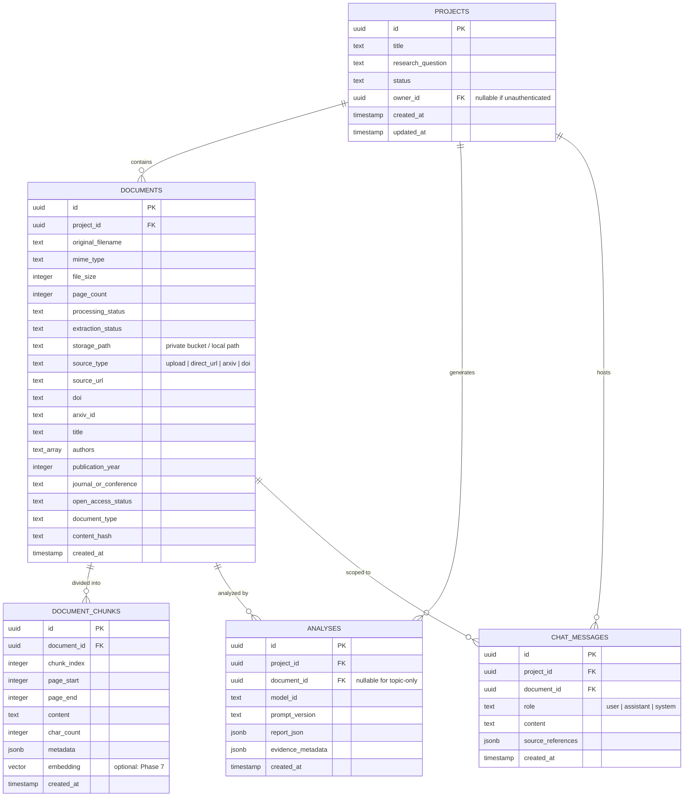

# AI Research Analyzer — Database Schema Specification

> **Status:** Provisional & Architectural Specification  
> **Source of Truth Reference:** `PROJECT_CONTEXT.md` §9, §14  
> **Target Database (upon approval):** PostgreSQL / Supabase with Row Level Security (RLS)

---

## 1. Overview & Strategy

As established in `PROJECT_CONTEXT.md`, no database credentials or persistent database providers have been confirmed yet. To maintain zero assumptions and prevent premature infrastructure commitments:
- **Phase 1 to Phase 5:** The application relies on in-memory and ephemeral local storage state to facilitate UI and core AI feature testing.
- **Phase 6:** A persistent database (e.g., Supabase / PostgreSQL) will be connected upon user approval, at which time the migrations defined below will be applied.

---

## 2. Entity-Relationship Model



---

## 3. Relational Schema Definitions (PostgreSQL DDL)

### 3.1 `projects`
Stores high-level research workspaces created by the user.

```sql
CREATE TABLE IF NOT EXISTS projects (
    id UUID PRIMARY KEY DEFAULT gen_random_uuid(),
    title TEXT NOT NULL,
    research_question TEXT,
    status TEXT NOT NULL DEFAULT 'active' CHECK (status IN ('active', 'archived', 'processing')),
    owner_id UUID, -- References auth.users(id) when Supabase Auth is enabled
    created_at TIMESTAMPTZ NOT NULL DEFAULT timezone('utc'::text, now()),
    updated_at TIMESTAMPTZ NOT NULL DEFAULT timezone('utc'::text, now())
);

CREATE INDEX idx_projects_owner ON projects(owner_id);
CREATE INDEX idx_projects_created_at ON projects(created_at DESC);
```

### 3.2 `documents`
Stores metadata and parsing results for uploaded PDF research files.

```sql
CREATE TABLE IF NOT EXISTS documents (
    id UUID PRIMARY KEY DEFAULT gen_random_uuid(),
    project_id UUID NOT NULL REFERENCES projects(id) ON DELETE CASCADE,
    original_filename TEXT NOT NULL,
    mime_type TEXT NOT NULL DEFAULT 'application/pdf',
    file_size INTEGER NOT NULL,
    page_count INTEGER,
    processing_status TEXT NOT NULL DEFAULT 'uploaded' CHECK (processing_status IN ('uploaded', 'parsing', 'extracted', 'failed')),
    extraction_status TEXT NOT NULL DEFAULT 'pending' CHECK (extraction_status IN ('pending', 'complete', 'scanned_no_text', 'error')),
    storage_path TEXT, -- Secure private path, never public
    created_at TIMESTAMPTZ NOT NULL DEFAULT timezone('utc'::text, now())
);

CREATE INDEX idx_documents_project ON documents(project_id);
```

### 3.3 `document_chunks`
Stores text segments partitioned by page or paragraph for prompt synthesis and grounded Q&A.

```sql
CREATE TABLE IF NOT EXISTS document_chunks (
    id UUID PRIMARY KEY DEFAULT gen_random_uuid(),
    document_id UUID NOT NULL REFERENCES documents(id) ON DELETE CASCADE,
    chunk_index INTEGER NOT NULL,
    page_start INTEGER NOT NULL,
    page_end INTEGER NOT NULL,
    content TEXT NOT NULL,
    char_count INTEGER NOT NULL,
    metadata JSONB DEFAULT '{}'::jsonb,
    created_at TIMESTAMPTZ NOT NULL DEFAULT timezone('utc'::text, now()),
    UNIQUE(document_id, chunk_index)
);

CREATE INDEX idx_document_chunks_doc ON document_chunks(document_id);
```

### 3.4 `analyses`
Stores the structured analytical reports generated by the Groq model.

```sql
CREATE TABLE IF NOT EXISTS analyses (
    id UUID PRIMARY KEY DEFAULT gen_random_uuid(),
    project_id UUID NOT NULL REFERENCES projects(id) ON DELETE CASCADE,
    document_id UUID REFERENCES documents(id) ON DELETE SET NULL,
    model_id TEXT NOT NULL,
    prompt_version TEXT NOT NULL,
    report_json JSONB NOT NULL,
    evidence_metadata JSONB NOT NULL DEFAULT '{}'::jsonb,
    created_at TIMESTAMPTZ NOT NULL DEFAULT timezone('utc'::text, now())
);

CREATE INDEX idx_analyses_project ON analyses(project_id);
CREATE INDEX idx_analyses_document ON analyses(document_id);
```

### 3.5 `chat_messages`
Stores conversation history for document-grounded question answering.

```sql
CREATE TABLE IF NOT EXISTS chat_messages (
    id UUID PRIMARY KEY DEFAULT gen_random_uuid(),
    project_id UUID NOT NULL REFERENCES projects(id) ON DELETE CASCADE,
    document_id UUID REFERENCES documents(id) ON DELETE CASCADE,
    role TEXT NOT NULL CHECK (role IN ('user', 'assistant', 'system')),
    content TEXT NOT NULL,
    source_references JSONB DEFAULT '[]'::jsonb,
    created_at TIMESTAMPTZ NOT NULL DEFAULT timezone('utc'::text, now())
);

CREATE INDEX idx_chat_messages_doc ON chat_messages(document_id, created_at ASC);
```

---

## 4. Security, Row Level Security (RLS) & Privacy

When connected to Supabase:
1. **Enable RLS on all tables:**
   ```sql
   ALTER TABLE projects ENABLE ROW LEVEL SECURITY;
   ALTER TABLE documents ENABLE ROW LEVEL SECURITY;
   ALTER TABLE document_chunks ENABLE ROW LEVEL SECURITY;
   ALTER TABLE analyses ENABLE ROW LEVEL SECURITY;
   ALTER TABLE chat_messages ENABLE ROW LEVEL SECURITY;
   ```
2. **Access Policies:**
   - Users can only read, create, update, or delete projects where `owner_id = auth.uid()`.
   - Child records (`documents`, `analyses`, `chat_messages`) inherit project ownership through relational constraints and policies.
3. **Storage Security:**
   - Uploaded PDF binary blobs are saved to a private storage bucket (`research-documents-private`).
   - Public read access is strictly forbidden; temporary signed URLs are used if client-side viewing is needed.
