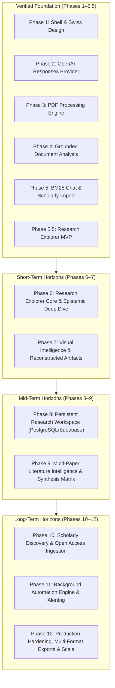

# MASTER DEVELOPMENT ROADMAP
## AI Research Analyzer — From PDF Analyzer to Academic Research Intelligence Platform

> **Document Status:** Authoritative Master Development Roadmap  
> **Version:** 2.0.0  
> **Last Synchronized:** 2026-11-05  
> **Workspace:** `E:\Research Analyzer`  
> **Current Git HEAD:** Verified Phase 5.5 Checkpoint  

---

## 1. Executive Vision: Academic Research Intelligence Platform

The ultimate mission of **AI Research Analyzer** is to build the world's most trustworthy, evidence-grounded academic research intelligence platform.

### From "PDF Chatbot" to "Research Explorer"
Traditional academic tooling treats AI as a conversational novelty: users upload a 30-page paper and are greeted with a chat box, forcing them to guess what questions to ask. Conversely, standard PDF readers present raw text without educational scaffolding.

**AI Research Analyzer** reverses this paradigm:
1. **Research-First Landing:** When a user uploads a PDF, enters an arXiv link, or resolves a DOI, the system immediately synthesizes an interactive **Research Explorer**.
2. **Dual-Lens Comprehension:** 
   - **Beginner Mode:** Translates dense academic terminology into plain English, provides pedagogical analogies, and explains *why* the findings matter.
   - **Researcher Mode:** Unpacks mathematical formulations, hyperparameter configurations, baseline controls, and statistical significance.
3. **Traceable Academic Integrity:** Every single assertion, metric, chart point, and diagram step is pinned to verifiable 1-indexed source document pages.
4. **Honest Epistemic Standards:** When a paper omits crucial details (e.g., negative results, random seeds, ethics statements), the platform explicitly badges them as `not_reported` or `not_established` rather than hallucinating plausible assumptions.
5. **Document Chat as an Ambient Assistant:** The chat engine remains fully preserved as a slide-out, page-grounded query dock accessible on demand.

---

## 2. Current Project Status & Verified Implementation (Phases 1–5.5)

Before outlining future roadmap phases, the following components represent **verified, existing, tested functionality**:

| Phase | Milestone | Verified Technical Implementation | Test Status |
|---|---|---|---|
| **Phase 1** | App Shell & Design System | Next.js 15 App Router, TypeScript strict, Tailwind CSS, Lucide icons, Swiss Modernism 2.0 tokens, error boundaries, accessible UI primitives. | Verified |
| **Phase 2** | Server-Side AI Inference | OpenAI SDK integration (`client.responses.create` with chat fallback), server-only secret isolation, zero client key exposure. | Verified |
| **Phase 3** | PDF Text & Metadata Engine | `unpdf` integration, page boundary preservation (1-indexed), scanned PDF detection (<50 chars), digital text validation. | Verified |
| **Phase 4** | Document Analysis & Grounding | 12-section structured report, 250,000 character context budgeter (100% full paper coverage), page citation pills with smooth scroll. | Verified |
| **Phase 5** | Document Chat & Paper Import | Deterministic BM25 retrieval across all pages, bounded conversation store, SSRF-hardened scholarly import (arXiv, DOI, Crossref, OpenAlex, Unpaywall). | Verified |
| **Phase 5.5** | Research Explorer Experience | 30-dimension data contracts, Zod schema coercions, executive canvas, at-a-glance grid, reconstructed charts, workflow diagrams, glossary, ambient chat dock. | 138/138 Passing |

---

## 3. Comprehensive Master Roadmap Overview

---

## 4. Detailed Phase Specifications

### Phase 6 — Research Explorer Core & Epistemic Deep Dive

#### 1. Objective
Elevate the Research Explorer into the primary, zero-friction destination for any research paper. Solidify the 30 academic dimensions into an intuitive, high-density reading workspace with claim-level epistemic verification.

#### 2. User Experience
- The user imports an academic paper and lands directly on the **Research Explorer** (no blank chat screen).
- A persistent quick-jump navigation rail allows one-click jumping between Foundation, Methodology, Experiments, Evaluation, and Impact clusters.
- Reading Mode switch (`Beginner` vs `Researcher`) smoothly adjusts all text cards without triggering re-inference.
- Highlighting any passage in the Extracted Pages view presents an instant "Explain in Context" prompt that seeds the Ambient Chat Dock.

#### 3. Features
- **P0 [MVP] Primary Explorer Navigation:** Sticky outline tracker with active scroll-spy across all 30 dimensions.
- **P0 [MVP] Instant Dual-Perspective Rendering:** Pre-rendered beginner intuition and technical formulation for every section.
- **P1 [MVP] Claim-Level Source Verification:** Clickable citation badges open the exact source page with passage highlighting.
- **P1 [MVP] Explicit Missing-Information Disclaimers:** Visual `not_reported` notices for unstated seeds, compute metrics, or datasets.
- **P2 [Advanced] Interactive Section Filtering:** Filter view by "Key Breakthroughs", "Methodological Details", or "Threats to Validity".

#### 4. Technical Architecture
- **Frontend:** `src/features/research-explorer/components/` (expanded with `OutlineNav`, `ReadingModeToggle`, `EpistemicBadge`).
- **State Management:** URL search params sync for `?mode=beginner|researcher` and `?section=sec-id`.
- **Backend:** `POST /api/documents/[id]/explore` with cached in-memory response handling.

#### 5. Code Reuse
- Reuses `ResearchExplorerData` type and `researchExplorerDataSchema`.
- Reuses `BudgetedDocument` context pipeline (`src/lib/pdf/budgeter.ts`).
- Reuses `AmbientChatDock` and `DocumentChat`.

#### 6. New Components (Provisional)
- `src/features/research-explorer/components/outline-nav.tsx`
- `src/features/research-explorer/components/epistemic-badge.tsx`
- `src/features/research-explorer/components/section-filter-bar.tsx`

#### 7. Dependencies
- Requires Phase 5.5 completion (Verified).

#### 8. Security & Reliability
- Strict input validation on focus areas and reading mode params.
- DOM sanitization for text excerpts.

#### 9. Testing Strategy
- Unit tests for outline navigation state changes.
- Integration tests ensuring citations scroll to the correct page in the extracted document tab.
- Regression tests for the 138 existing tests.

#### 10. Acceptance Criteria
1. Default document workspace route lands on Research Explorer.
2. Switching reading modes does not initiate network calls.
3. Every citation click smoothly reveals the source page.

#### 11. Git Checkpoint
`feat(phase-6): implement core Research Explorer navigation, reading modes, and epistemic verification`

#### 12. Remaining Limitations
Data is still stored in ephemeral memory (ADR-004). Database persistence arrives in Phase 8.

---

### Phase 7 — Visual Intelligence & Reconstructed Scientific Artifacts

#### 1. Objective
Transform dense quantitative tables and algorithmic descriptions into clear, interactive SVG visualizations without hallucination.

#### 2. User Experience
- Readers view benchmark comparisons as responsive, interactive bar and line charts.
- Methodology pipelines appear as structured node-and-edge process maps.
- Hovering over chart data points displays the exact table and page number where the author reported the value.

#### 3. Features
- **P0 [MVP] Tabular Benchmark Reconstruction:** Interactive SVG charts from explicit tabular values.
- **P0 [MVP] Zero-Hallucination Guardrails:** Strict rejection of charts if numbers are not explicitly verified in passages.
- **P1 [MVP] Methodological Flowcharts:** Pipeline diagrams with expandable technical notes per stage.
- **P2 [Advanced] PDF Vector Figure Extraction:** Investigation of client-side canvas rendering for original embedded PDF figures.
- **P3 [Future] Interactive Parameter Playground:** Slider widgets for theoretical equations where coefficients are known.

#### 4. Technical Architecture
- **Charting Engine:** Pure SVG/CSS rendering (or lightweight `recharts`/`lucide` primitives) with zero bundle bloat.
- **AI Extraction:** Enhanced prompt requiring exact table headers, row names, and numerical units.

#### 5. Code Reuse
- Reuses `reconstructedChartSchema` and `workflowDiagramSchema`.
- Reuses `ReconstructedChartsView` and `WorkflowDiagramView`.

#### 6. New Components (Provisional)
- `src/features/research-explorer/components/svg-chart-renderer.tsx`
- `src/features/research-explorer/components/pipeline-stage-modal.tsx`
- `src/lib/pdf/figure-extractor.ts` (Feasibility probe)

#### 7. Dependencies
- Requires Phase 6 completion.

#### 8. Security & Reliability
- SVG sanitation to prevent SVG-based XSS injection.
- Rejection of invalid numerical values (`NaN`, infinite loops).

#### 9. Testing Strategy
- Unit test verifying non-numerical table data fails chart validation cleanly.
- Visual regression test for responsive SVG sizing on mobile.

#### 10. Acceptance Criteria
1. Visual charts render accurately for benchmark tables with unit labels.
2. Papers with no tabular data show an honest absence card without throwing errors.

#### 11. Git Checkpoint
`feat(phase-7): implement visual intelligence, interactive SVG charts, and methodology pipelines`

#### 12. Remaining Limitations
Bitmapped raster diagrams inside scanned PDFs cannot be vector-reconstructed without multimodal vision OCR.

---

### Phase 8 — Persistent Research Workspace (PostgreSQL / Supabase)

#### 1. Objective
Transition from ephemeral server memory (ADR-004) to robust, durable relational persistence with user accounts, project folders, and document archiving.

#### 2. User Experience
- Users can log in, create research projects (e.g., "PhD Thesis — Transformer Efficiency"), and save papers.
- Analyses, explorer states, and chat histories persist across sessions and devices.
- Users can search their personal research library by keywords, authors, DOIs, or custom tags.

#### 3. Features
- **P0 [MVP] Relational Persistence:** PostgreSQL schema with Supabase or Prisma/Drizzle ORM.
- **P0 [MVP] Paper File Storage:** Secure object storage (Supabase Storage or Cloudflare R2 / AWS S3) for uploaded PDF binaries.
- **P0 [MVP] Document & Explorer Storage:** Durable JSONB storage for `ResearchExplorerData` and `DocumentAnalysisReport`.
- **P1 [MVP] Conversation History Persistence:** Chat messages stored relationally with foreign keys to documents.
- **P1 [MVP] Research Projects & Tagging:** Organization of documents into folders and semantic collections.
- **P2 [Advanced] Row-Level Security (RLS):** Strict isolation ensuring users only access their authorized workspaces.

#### 4. Technical Architecture
- **Database:** PostgreSQL (via Supabase or Neon serverless).
- **ORM:** Drizzle ORM or Prisma for strict TypeScript schema synchronization.
- **Object Storage:** S3-compatible blob storage with pre-signed upload URLs.
- **Schema Reference:** Implements `docs/DATABASE_SCHEMA.md`.

#### 5. Code Reuse
- Replaces in-memory implementations in `src/lib/storage/document-store.ts` and `conversation-store.ts` while preserving their exact async interfaces.

#### 6. New Components (Provisional)
- `src/lib/db/client.ts`
- `src/lib/db/schema.ts`
- `src/lib/storage/s3-storage.ts`
- `src/features/projects/` (Project management UI)

#### 7. Dependencies
- Requires Phase 6 and Phase 7 completion.

#### 8. Security & Reliability
- Row-Level Security (RLS) enforcement.
- Pre-signed URLs with 15-minute expirations.
- Database connection pooling via PgBouncer.

#### 9. Testing Strategy
- Integration tests against test database containers (Testcontainers or Supabase local CLI).
- Migration rollback and forward verification.

#### 10. Acceptance Criteria
1. Server restart does not erase uploaded documents or chat sessions.
2. DocumentStore integration tests pass against PostgreSQL.

#### 11. Git Checkpoint
`feat(phase-8): integrate PostgreSQL relational database, blob storage, and durable research projects`

#### 12. Remaining Limitations
Multi-user shared workspaces and collaborative live cursors are reserved for enterprise extensions.

---

### Phase 9 — Multi-Paper Literature Intelligence & Synthesis Matrix

#### 1. Objective
Empower researchers to compare multiple academic papers simultaneously, synthesizing cross-paper agreements, contradictions, methodological variations, and collective research gaps.

#### 2. User Experience
- Users select 2 to 5 papers in their library and click "Synthesize Literature".
- Generates an interactive **Literature Review Matrix** displaying side-by-side comparisons of Objectives, Datasets, Baselines, Metrics, and Findings.
- Highlights conflicting findings between papers (e.g., Paper A finds Method X superior on Dataset D1, while Paper B finds Method Y superior on Dataset D2).

#### 3. Features
- **P0 [MVP] Cross-Paper Synthesis Matrix:** Tabular comparison of methodologies, datasets, and benchmark results.
- **P1 [MVP] Contradiction & Consensus Detector:** Identifies empirical agreements and disagreements across selected literature.
- **P1 [MVP] Collective Research Gap Synthesis:** Aggregates individual paper limitations to highlight open research directions.
- **P2 [Advanced] Literature Review Draft Generator:** Produces publication-ready synthesis prose with multi-paper citation brackets.

#### 4. Technical Architecture
- **API:** `POST /api/research/synthesize` accepting an array of `documentIds`.
- **Prompt Architecture:** Multi-document prompt structuring evidence boundaries by `[Paper 1: Title]` and `[Paper 2: Title]`.

#### 5. Code Reuse
- Reuses `ResearchExplorerData.atAGlance` and `sections` from each selected document.
- Reuses existing token budgeter across multiple paper summaries.

#### 6. New Components (Provisional)
- `src/features/multi-paper/components/synthesis-matrix.tsx`
- `src/features/multi-paper/components/consensus-badge.tsx`
- `src/lib/ai/synthesis-prompts.ts`
- `src/app/api/research/synthesize/route.ts`

#### 7. Dependencies
- Requires Phase 8 (Persistent Research Workspace).

#### 8. Security & Reliability
- Cross-document boundary isolation ensuring Paper A's claims are never attributed to Paper B.

#### 9. Testing Strategy
- Unit tests verifying multi-document citation parsing.
- Integration tests verifying synthesis generation for 3 simultaneous papers.

#### 10. Acceptance Criteria
1. Matrix renders clean side-by-side rows for at least 3 papers.
2. Every multi-paper statement cites the specific paper identifier and page.

#### 11. Git Checkpoint
`feat(phase-9): implement multi-paper synthesis matrix, consensus detection, and literature review builder`

#### 12. Remaining Limitations
Comparing more than 10 papers simultaneously requires hierarchical MapReduce summarization to fit context windows.

---

### Phase 10 — Scholarly Discovery & Open Access Ingestion

#### 1. Objective
Enable proactive literature search and citation graph exploration directly inside the platform, connecting papers to external scholarly registries.

#### 2. User Experience
- Search bar allows querying academic papers by topic, keyword, or author across OpenAlex, Semantic Scholar, and Crossref.
- Direct indicator pills show whether a paper is **Open Access** (Gold, Green, Bronze) or behind a publisher paywall.
- One-click import button fetches available open-access PDFs directly into the workspace.

#### 3. Features
- **P0 [MVP] Scholarly Literature Search:** Search interface backed by OpenAlex and Crossref APIs.
- **P1 [MVP] Open Access Verification:** Verification of public full-text availability before ingestion.
- **P1 [MVP] Related Paper Discovery:** "More Like This" recommendations based on citation graphs and co-citations.
- **P2 [Advanced] Citation Graph Traversal:** Interactive visual graph showing incoming and outgoing citations.

#### 4. Technical Architecture
- **Backend Adapters:** `src/lib/discovery/openalex-adapter.ts`, `src/lib/discovery/semantic-scholar-adapter.ts`.
- **Rate Limiting:** Token-bucket rate limiter for academic API quotas.

#### 5. Code Reuse
- Reuses `src/lib/import/source-resolver.ts` and `ssrf-defense.ts`.

#### 6. New Components (Provisional)
- `src/features/discovery/components/scholarly-search.tsx`
- `src/features/discovery/components/paper-result-card.tsx`
- `src/app/discovery/page.tsx`
- `src/app/api/discovery/search/route.ts`

#### 7. Dependencies
- Requires Phase 8.

#### 8. Security & Reliability
- Strict adherence to publisher access rules (no paywall bypass or unauthorized scraping).
- Caching of external API queries to avoid rate-limit exhaustion.

#### 9. Testing Strategy
- Unit tests with mock API responses for OpenAlex and Semantic Scholar.
- Rate limiter verification under simulated load.

#### 10. Acceptance Criteria
1. Academic keyword searches return verified papers with real DOIs and publication metadata.
2. Open Access papers can be imported in 1 click without errors.

#### 11. Git Checkpoint
`feat(phase-10): integrate scholarly literature search, OpenAlex discovery, and citation exploration`

#### 12. Remaining Limitations
Paywalled papers display only title, abstract, and official DOI landing links.

---

### Phase 11 — Background Automation Engine & Alerting

#### 1. Objective
Upgrade the synchronous in-memory Event Bus into a resilient background job processing engine capable of asynchronous document processing, workflow retries, and scheduled research monitoring.

#### 2. User Experience
- Large document uploads (e.g., 80-page dissertations) process in the background with real-time progress bars; users can navigate away without interrupting processing.
- Users can subscribe to research topics and receive automated weekly research digests summarizing newly published preprints.

#### 3. Features
- **P0 [MVP] Asynchronous Document Processing:** Background worker queue for PDF text extraction and explorer generation.
- **P1 [MVP] Job Status & Progress Tracking:** Real-time polling or WebSocket/SSE updates for long-running analyses.
- **P1 [MVP] Workflow Retries & Fault Tolerance:** Automatic exponential backoff for transient AI provider rate limits.
- **P2 [Advanced] Scheduled Research Topic Monitoring:** Weekly automated retrieval of new arXiv publications matching saved user queries.

#### 4. Technical Architecture
- **Job Engine Options:** Evaluation of Inngest, Trigger.dev, or PostgreSQL-backed BullMQ/Graphile Worker.
- **Notification Layer:** Server-Sent Events (SSE) or Webhook events for client updates.

#### 5. Code Reuse
- Replaces synchronous `src/lib/events/event-bus.ts` with durable job dispatching.

#### 6. New Components (Provisional)
- `src/lib/queue/jobs.ts`
- `src/lib/queue/worker.ts`
- `src/app/api/jobs/[id]/status/route.ts`

#### 7. Dependencies
- Requires Phase 8 (Persistent Database).

#### 8. Security & Reliability
- Dead-letter queues for malformed PDFs.
- Idempotency keys preventing duplicate processing charges.

#### 9. Testing Strategy
- End-to-end test simulating network dropouts during document processing.
- Queue retry verification upon mock 429 provider errors.

#### 10. Acceptance Criteria
1. Large document analysis completes asynchronously without HTTP request timeouts.
2. Failed jobs retry automatically with exponential backoff.

#### 11. Git Checkpoint
`feat(phase-11): implement asynchronous background queue, job tracking, and scheduled research alerts`

#### 12. Remaining Limitations
Self-hosted Redis or serverless queue infrastructure adds operational maintenance costs.

---

### Phase 12 — Production Hardening, Multi-Format Exports & Scale

#### 1. Objective
Prepare the platform for production-grade reliability, international academic standards, publication-quality exports, and global cloud deployment.

#### 2. User Experience
- 1-click export of research explorations into **LaTeX / BibTeX**, **Structured Markdown**, **Microsoft Word (`.docx`)**, and **Publication-Ready PDF**.
- Full WCAG 2.1 AA accessibility compliance (screen reader support, high-contrast modes, full keyboard navigation).
- Sub-second UI response times with optimized edge caching.

#### 3. Features
- **P0 [MVP] Publication-Grade Exports:** LaTeX/BibTeX citation generator, clean Word `.docx`, and print-styled vector PDF.
- **P1 [MVP] Performance & Bundle Optimization:** Dynamic code splitting, image optimization, edge API route caching.
- **P1 [MVP] Observability & Auditing:** Structured JSON audit logging, OpenTelemetry tracing, and error monitoring (Sentry).
- **P2 [Advanced] Team Workspaces & Sharing:** Read-only shareable links for research exploration canvases.

#### 4. Technical Architecture
- **Export Engines:** Client/server document generators (`docx`, `jspdf`/print stylesheets, BibTeX formatting).
- **Hosting:** Vercel Edge Network / AWS CloudFront.
- **Monitoring:** Sentry error tracking + Vercel Web Analytics.

#### 5. Code Reuse
- Reuses existing Word `.doc` and vector PDF print engines in `src/features/research-explorer/components/research-explorer.tsx`.

#### 6. New Components (Provisional)
- `src/lib/export/latex-exporter.ts`
- `src/lib/export/bibtex-exporter.ts`
- `src/features/export/components/export-modal.tsx`

#### 7. Dependencies
- Requires Phases 6 through 11.

#### 8. Security & Reliability
- OWASP Top 10 compliance audit.
- CSP headers, rate-limiting, and DDoS protection via Cloudflare or Vercel Edge Middleware.

#### 9. Testing Strategy
- Automated Lighthouse accessibility and performance audits (Scores >= 95).
- Full end-to-end Playwright test suite across mobile and desktop viewports.

#### 10. Acceptance Criteria
1. All exports format citations correctly in APA, IEEE, and BibTeX styles.
2. Zero security vulnerabilities in `pnpm audit`.

#### 11. Git Checkpoint
`feat(phase-12): achieve production hardening, LaTeX/BibTeX exports, and WCAG accessibility standards`

#### 12. Remaining Limitations
Local self-hosted on-premise air-gapped deployments require custom enterprise containerization.

---

## 5. Priority Classification & Implementation Matrix

| Phase | Feature Name | Priority | Category | Key Benefit |
|---|---|---|---|---|
| **Phase 6** | Research Explorer Primary Landing | **P0** | MVP | Transforms app from chat to structured intelligence |
| **Phase 6** | Beginner vs Researcher Mode Switcher | **P0** | MVP | Accessible to students and researchers alike |
| **Phase 6** | Claim-Level Source Verification | **P1** | MVP | Zero hallucination with 1-indexed page links |
| **Phase 7** | Tabular Benchmark SVG Charts | **P0** | MVP | Visual understanding without invented data |
| **Phase 7** | Methodology Pipeline Diagrams | **P1** | MVP | Step-by-step clarity on algorithms |
| **Phase 8** | PostgreSQL / Supabase Database | **P0** | MVP | Persistent documents and user projects |
| **Phase 8** | S3 / R2 Object Storage | **P0** | MVP | Durable PDF binary storage |
| **Phase 9** | Multi-Paper Literature Matrix | **P0** | Advanced | Compares 3+ papers side-by-side |
| **Phase 9** | Consensus & Contradiction Detection | **P1** | Advanced | Highlights empirical discrepancies |
| **Phase 10** | OpenAlex & Crossref Academic Search | **P0** | Advanced | In-app paper discovery without external browser |
| **Phase 10** | Open Access Link Verification | **P1** | Advanced | Distinguishes free PDFs from paywalls |
| **Phase 11** | Background Job Processing Queue | **P0** | Advanced | Handles 100+ page books asynchronously |
| **Phase 11** | Weekly Research Topic Digests | **P2** | Future | Automated preprint monitoring |
| **Phase 12** | LaTeX / BibTeX / Word Exports | **P0** | Production | Academic paper publishing workflows |
| **Phase 12** | Sentry Observability & Telemetry | **P1** | Production | 99.9% uptime and error tracking |

---

## 6. Cost & Technology Evaluation

| Architecture Tier | Evaluated Technologies | Recommendation | Cost & Rationale |
|---|---|---|---|
| **AI Inference** | OpenAI `gpt-4o-mini`, `gpt-4o`, Anthropic Claude | **OpenAI `gpt-4o-mini`** (Primary) | Extremely economical (~$0.15/1M input tokens), 128k context window, structured JSON reliability. Fallback to `gpt-4o` for dense mathematical proofs. |
| **Database** | PostgreSQL on Supabase vs Neon vs AWS RDS | **Supabase (PostgreSQL)** | Generous free tier (500MB DB, 1GB storage, 50k monthly active users), built-in Row-Level Security, instant REST APIs. |
| **Blob Storage** | Cloudflare R2 vs AWS S3 vs Supabase Storage | **Cloudflare R2** | Zero egress fees, standard S3 API, $0.015/GB/month. Significantly cheaper than AWS S3 egress. |
| **Scholarly APIs** | OpenAlex, Crossref, Semantic Scholar | **OpenAlex + Crossref** | Completely free, CC0/open licensing, generous rate limits (10 req/sec), no paid subscription required. |
| **Background Jobs** | Inngest vs Trigger.dev vs BullMQ | **Inngest (Serverless)** | Zero infra maintenance, integrates seamlessly with Next.js App Router, free tier handles 50k events/month. |
| **Vector DB** | Pinecone, Qdrant, pgvector | **Deterministic BM25 (Preserved)** | Keep existing deterministic BM25 search. Zero vector database cost, zero embedding API costs, 100% reproducible keyword citation matching. |

---

## 7. Mandatory Instructions for Future AI Agents

Any AI developer or agent operating in this codebase must strictly observe these rules:

1. **Context Synchronization First:** Read `docs/PROJECT_CONTEXT.md` and `docs/MASTER_ROADMAP.md` before making any modifications.
2. **Phase Boundary Enforcement:** Implement **only** the phase explicitly authorized by the user. Never begin future phases unilaterally.
3. **Preserve Completed Functionality:** All Phase 1–5.5 features (PDF extraction, budgeter, BM25 retriever, paper import, research explorer) must remain 100% operational.
4. **Mandatory Testing:** Every new feature must include comprehensive unit and integration tests. All existing test suites must pass before finishing.
5. **Type Safety & Zero Secrets:** `tsc --noEmit` must pass with 0 errors. OpenAI API keys must remain strictly server-side.
6. **Documentation Synchronization:** Update `docs/DEVELOPMENT_PROGRESS.md` and relevant specifications at the conclusion of every phase.
