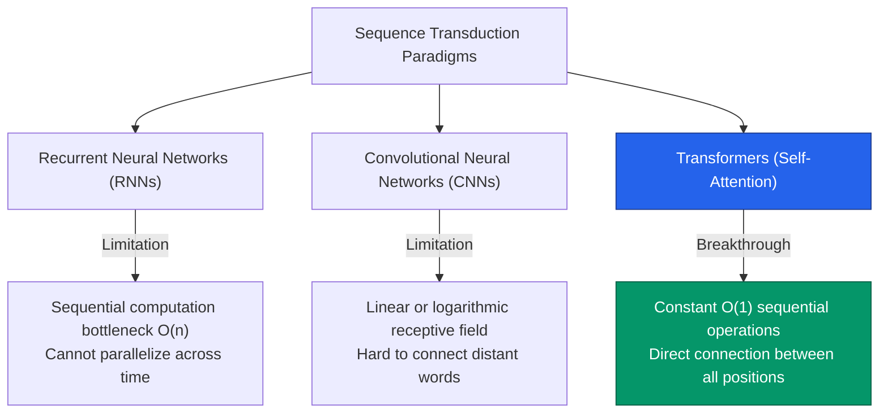

# Research Explorer & Intelligence Experience Specification
## Platform Product Vision, Information Architecture, and System Design

> **Document Status:** Authoritative Product & Experience Specification  
> **Target System:** AI Research Analyzer  
> **Workspace Location:** `docs/RESEARCH_EXPERIENCE_SPEC.md`  
> **Version:** 1.0.0  
> **Date:** November 2026  
> **Audience:** Product Managers, System Architects, Full-Stack Engineers, UX Designers, Academic Reviewers  

---

## Table of Contents

1. [Executive Summary & Product Vision](#1-executive-summary--product-vision)
2. [Target Audience & User Personas](#2-target-audience--user-personas)
3. [Current UX Audit & Critical Problem Analysis](#3-current-ux-audit--critical-problem-analysis)
4. [The Research Explorer Paradigm](#4-the-research-explorer-paradigm)
5. [The 30-Section Progressive Exploration Structure](#5-the-30-section-progressive-exploration-structure)
6. [Dual Learning Experience: Beginner vs. Researcher Modes](#6-dual-learning-experience-beginner-vs-researcher-modes)
7. [Data Visualization Engine (Charts & Reconstructions)](#7-data-visualization-engine-charts--reconstructions)
8. [Methodology & Conceptual Diagrams Engine](#8-methodology--conceptual-diagrams-engine)
9. [Academic Integrity, Traceability & 4-Tier Evidence Contract](#9-academic-integrity-traceability--4-tier-evidence-contract)
10. [Repositioning Document Chat: From Chatbot to Ambient Assistant](#10-repositioning-document-chat-from-chatbot-to-ambient-assistant)
11. [Scope Boundaries: Single-Paper vs. Multi-Paper vs. External Field Intelligence](#11-scope-boundaries-single-paper-vs-multi-paper-vs-external-field-intelligence)
12. [Technical Capabilities & PDF Extraction Reality Audit](#12-technical-capabilities--pdf-extraction-reality-audit)
13. [Information Architecture & UI/UX Wireframe Specifications](#13-information-architecture--uiux-wireframe-specifications)
14. [Updated Product Roadmap & Phased Implementation Strategy](#14-updated-product-roadmap--phased-implementation-strategy)
15. [Acceptance Criteria & Verification Framework](#15-acceptance-criteria--verification-framework)

---

## 1. Executive Summary & Product Vision

### 1.1 The Shift from Conversational Chat to Deep Academic Intelligence
The first generation of generative AI document tools popularized the **"PDF Chatbot"** metaphor: users upload a PDF and are presented with a conversational dialogue window. While accessible, this interaction pattern suffers from fundamental shortcomings when applied to scholarly inquiry:

1. **The Burden of Inquiry on the User:** Chatbots require the user to already know which questions to ask. Novice researchers, undergraduate students, and multidisciplinary scholars frequently do not know what constitutes the methodological vulnerabilities, baseline omissions, or statistical validity risks of a paper.
2. **Ephemerality & Lack of Structure:** Conversational answers are fragmented across message bubbles, lacking the persistent, hierarchical organization essential to scientific literature review.
3. **Superficial Text Summaries:** Generic chatbot responses generate prose paraphrases rather than structured analytical extractions (e.g., experimental conditions, variable relationships, benchmark score differentials, threats to internal validity).

**The AI Research Analyzer rejects the chatbot-first model.**

Our vision is to build an **AI-Powered Academic Research Intelligence and Paper Understanding Platform**. When a paper is imported (via local PDF, arXiv ID, scholarly DOI, or direct HTTPS link), the primary landing interface is **The Research Explorer**: an interactive, structured, visually rich, and deeply grounded workspace designed to unpack, explain, verify, and contextualize scientific publications from beginning to end.

Document Chat is preserved, but deliberately repositioned as a **supporting ambient assistant**—available on demand to clarify nuances, answer ad-hoc questions, and decode equations, rather than acting as the primary product interface.

```
       TRADITIONAL PDF TOOLS                   AI RESEARCH ANALYZER
      ┌────────────────────────┐             ┌───────────────────────────────────┐
      │   Upload PDF           │             │   Multi-Source Scholarly Ingest   │
      └───────────┬────────────┘             └─────────────────┬─────────────────┘
                  │                                            │
                  ▼                                            ▼
      ┌────────────────────────┐             ┌───────────────────────────────────┐
      │  Empty Chat Interface   │             │       RESEARCH EXPLORER           │
      │  "Ask me anything..."  │             │  • Verified Scholarly Identity    │
      └────────────────────────┘             │  • Executive Research Canvas      │
                  │                          │  • Dual-Mode Learning Lens        │
                  ▼                          │  • 30-Point Progressive Structure │
      ┌────────────────────────┐             │  • Grounded Data Visualizations   │
      │ Unstructured Answers   │             │  • Workflow & Conceptual Diagrams │
      │ Risk of Hallucination  │             │  • 4-Tier Citation Grounding      │
      └────────────────────────┘             └─────────────────┬─────────────────┘
                                                               │
                                                               ▼
                                             ┌───────────────────────────────────┐
                                             │    Contextual Research Dock       │
                                             │ (Chat, PDF Pages, Export Suite)   │
                                             └───────────────────────────────────┘
```

---

## 2. Target Audience & User Personas

The platform serves five distinct user personas across their respective educational and professional journeys:

| User Persona | Background & Skill Level | Core Pain Points | Research Explorer Value Proposition |
|---|---|---|---|
| **Undergraduate & First-Time Students** | Learning research literacy; intimidated by academic jargon, complex math notation, and dense formatting. | Cannot decipher what the paper accomplished; struggles with Greek notation and statistical abbreviations; cannot assess whether conclusions are justified. | **Beginner Mode:** Plain-language decoding, interactive glossary tooltips, conceptual flowcharts, and clear answers to *"Why does this matter?"* and *"What did they discover?"* |
| **Graduate & Master's Students** | Familiar with academic structure; conducting systematic literature searches and methodology assessments. | Overwhelmed by volume; spending hours manually extracting datasets, baselines, and benchmark scores; difficulty identifying research gaps for thesis topics. | **Standardized 30-Section Extraction:** Immediate extraction of baselines, datasets, experimental parameters, research gaps, and threats to validity. |
| **Doctoral & Postdoctoral Researchers** | High domain expertise; evaluating state-of-the-art contributions, replication feasibility, and subtle experimental flaws. | Needs exact page citations; requires distinction between empirical proof and speculative author claims; needs verification of baseline fairness. | **Researcher Mode & Traceability:** Page-anchored quotes, strict separation between empirical evidence and model interpretation, and statistical integrity auditing. |
| **Cross-Disciplinary & Independent Researchers** | Strong analytical skills in their home domain; reading papers in adjacent or newly emerging disciplines (e.g., ML for biology). | Lacks sub-field taxonomy; unfamiliar with domain-specific benchmark conventions, standard evaluation protocols, or historical debates. | **Dual-Lens Toggle:** Rapidly switch to Beginner Mode to understand unfamiliar subfield paradigms, then switch to Researcher Mode for technical details. |
| **Academic Professionals & Reviewers** | Senior faculty, journal referees, and principal investigators. | Time-constrained; needs rapid sanity checks on methodology rigor, dataset availability, code release, and potential ethical/reproducibility flags. | **At-a-Glance Fact Sheet & Visual Breakdown:** Rapid extraction of limitations, baseline omissions, and reproducibility notes with zero hallucinated figures. |

---

## 3. Current UX Audit & Critical Problem Analysis

### 3.1 Review of Current Document Workspace
In the current Phase 5 build ([`src/features/pdf-analysis/components/document-viewer.tsx`](file:///E:/Research%20Analyzer/src/features/pdf-analysis/components/document-viewer.tsx)), the user experience presents three top-level tabs upon document ingestion:
1. `Document Chat & Q&A`
2. `Extracted Document Pages (N)`
3. `Structured Research Report` (visible only after explicit on-demand generation)

### 3.2 Observed UX Deficiencies

1. **Defaulting to Conversation Over Understanding:**  
   Landing the user in a chat interface immediately shifts cognitive burden onto the user. A user who has just imported a 30-page paper on *State Space Models in Genomics* is greeted with an empty input box. They do not yet know the paper's contents well enough to formulate high-value queries.
2. **Analysis Hidden Behind an Explicit Trigger Action:**  
   The deep analysis report is gated behind a secondary "Generate Grounded Report" button. Users perceive the platform as a chat tool with an optional summary generator, rather than a specialized intelligence platform.
3. **Linear Text Presentation of Complex Data:**  
   When the existing report generates, it renders as a vertical stack of Markdown text cards. Complex empirical benchmarks (e.g., BLEU scores, perplexity, training FLOPs) are represented as flat prose bullet points instead of interactive comparison tables or data charts.
4. **Binary Reader Assumption:**  
   The current report writes at a single technical register. It is often too dense for undergraduate learners seeking conceptual clarity, yet lacks the granular parameter breakdowns desired by senior peer reviewers.
5. **No Architectural Distinction Between Single-Paper Findings and Field-Wide Context:**  
   If a model comments on the broader field during chat or analysis, there is insufficient UI signaling distinguishing whether a fact was claimed by the authors on Page 4 or synthesized by the model from general scientific background knowledge.

---

## 4. The Research Explorer Paradigm

### 4.1 First Contact: The Primary Landing Canvas
Upon successful upload or scholarly import of a paper, the user lands directly on **The Research Explorer**. The interface is organized into three progressive, highly visual tiers:

```
┌──────────────────────────────────────────────────────────────────────────────────────────────┐
│  RESEARCH IDENTITY HEADER                                                                    │
│  [Paper Title]                                                                               │
│  Authors: A. Vaswani, N. Shazeer et al. • 2017 • NeurIPS • DOI: 10.5555/3295222 • 11 Pages  │
│  Domain: Deep Learning / NLP • Source: arXiv (Open Access) • Reading Mode: [Beginner | Expert]│
├──────────────────────────────────────────────────────────────────────────────────────────────┤
│  EXECUTIVE RESEARCH OVERVIEW (Dual-Perspective Synthesis)                                    │
│  ┌───────────────────────────────────────────┐ ┌───────────────────────────────────────────┐  │
│  │ Plain-Language Explanation (Beginner)     │ │ Technical Research Contribution (Expert)  │  │
│  │ "This paper replaces recurrent step-by-   │ │ "Introduces the Transformer, eliminating   │  │
│  │ step processing with parallel attention..."│ │ recurrence and convolutions entirely..."   │  │
│  └───────────────────────────────────────────┘ └───────────────────────────────────────────┘  │
├──────────────────────────────────────────────────────────────────────────────────────────────┤
│  RESEARCH AT A GLANCE (Structured Intelligence Metric Grid)                                  │
│  ┌──────────────────┐ ┌──────────────────┐ ┌──────────────────┐ ┌──────────────────┐         │
│  │ CORE OBJECTIVE   │ │ METHODOLOGY      │ │ BENCHMARK DATA   │ │ KEY EMPIRICAL    │         │
│  │ Eliminate RNN    │ │ Self-Attention   │ │ WMT 2014 En-De   │ │ +2.1 BLEU over   │         │
│  │ recurrence       │ │ Multi-Head Mech  │ │ (4.5M pairs)     │ │ previous SOTA    │         │
│  │ [Page 2]         │ │ [Pages 3-5]      │ │ [Page 6]         │ │ [Page 7]         │         │
│  └──────────────────┘ └──────────────────┘ └──────────────────┘ └──────────────────┘         │
│  ┌──────────────────┐ ┌──────────────────┐ ┌──────────────────┐ ┌──────────────────┐         │
│  │ COMPUTATIONAL    │ │ REPORTED         │ │ REPRODUCIBILITY  │ │ ETHICAL STATUS   │         │
│  │ 3.5 days on 8x   │ │ Quadratic memory │ │ Code Released:   │ │ Not Discussed    │         │
│  │ NVIDIA P100 GPUs │ │ complexity O(n²) │ │ github.com/...   │ │ (Not Reported)   │         │
│  │ [Page 7]         │ │ [Page 6]         │ │ [Page 10]        │ │ [Unestablished]  │         │
│  └──────────────────┘ └──────────────────┘ └──────────────────┘ └──────────────────┘         │
└──────────────────────────────────────────────────────────────────────────────────────────────┘
```

### 4.2 Progressive Disclosure Information Architecture
To prevent cognitive overload from a monolithic 30-section document, the Research Explorer employs a **segmented, multi-tier navigation layout**:

- **Sticky Navigation Ribbon:** Allows jumping across 7 thematic clusters:
  1. *Foundation & Context* (Sections 1–8)
  2. *Methodology & Design* (Sections 9–15)
  3. *Experiments & Results* (Sections 16–21)
  4. *Visualizations & Figures* (Data charts, workflow diagrams)
  5. *Critical Evaluation* (Sections 22–26: Strengths, Limitations, Validity, Ethics)
  6. *Future Impact & Glossary* (Sections 27–30)
  7. *Interactive Workbench* (Grounded Chat & Page Reader)

---

## 5. The 30-Section Progressive Exploration Structure

Every research paper ingested by the platform is systematically evaluated across thirty structured academic dimensions. If a paper does not address an item (e.g., omitting ethical considerations or threats to validity), the platform **explicitly registers "Not Reported in Paper"** rather than omitting the section or hallucinating content.

### Section Breakdown & Grounding Matrix

| # | Section Name | Target Information Extracted | Beginner Lens | Researcher Lens | Evidence Standard |
|---|---|---|---|---|---|
| **1** | **Research Identity & Provenance** | Title, verified authors, affiliations, year, publication venue, DOI, arXiv ID, license/open-access status, page count. | Academic background & citation guidance. | Full metadata, bibtex formatting, source provenance. | `from_document` / metadata resolver |
| **2** | **Beginner-Friendly Explanation** | High-level intuitive synthesis answering *"What is this, why does it matter, and how does it work?"* using clean analogies without distorting mathematical rigor. | Analogy-driven mental model. | Executive abstract summary. | `ai_interpretation` (grounded in document facts) |
| **3** | **Background & Related Work** | Historical context, antecedent literature, foundational theories, and paradigms the authors build upon or dispute. | *"What came before this paper?"* | Prior paradigm taxonomy and cited foundational works. | `from_document` (with page citations) |
| **4** | **Research Problem & Motivation** | The concrete scientific or technical challenge the authors attempt to overcome. | Practical breakdown of the bottleneck or puzzle. | Formal problem statement, mathematical formulation if present. | `from_document` |
| **5** | **Research Questions & Objectives** | Specific inquiry statements, formal goals, and project scopes defined by the authors. | Bulleted plain questions the paper sets out to answer. | Formal operational objectives and scopes. | `from_document` |
| **6** | **Scientific Hypotheses** | Explicitly stated or mathematically formulated hypotheses being subjected to empirical testing. | Simple prediction: *"The authors hypothesized that..."* | Formal null/alternative hypothesis statements ($H_0, H_1$) or "Not Formally Formulated". | `from_document` or `not_reported` |
| **7** | **Identified Research Gap** | The precise deficiency, unstudied condition, or technical limitation in prior literature addressed by this paper. | *"What was missing in earlier research?"* | State-of-the-art frontier analysis and void identification. | `from_document` |
| **8** | **Core Research Contributions** | Itemized list of novel intellectual contributions (e.g., new algorithm, new dataset, empirical discovery, theoretical proof). | Summary of what the authors gave the world. | Granular list of methodological, empirical, or theoretical novelties. | `from_document` |
| **9** | **Methodology Overview** | High-level architecture and methodological philosophy adopted. | Overview of the recipe or strategy. | Paradigmatic framework classification (e.g., semi-supervised, double-blind, quasi-experimental). | `from_document` |
| **10** | **Research Design & Workflow** | Step-by-step experimental or analytical structure, control mechanisms, and phased execution flow. | Step 1, 2, 3 diagrammatic guide. | Formal study design, ablation controls, and protocol specification. | `from_document` (supported by workflow diagram) |
| **11** | **Data Collection Procedures** | How empirical data, corpus text, or observations were gathered, sampled, scraped, or generated. | *"Where did they get their data?"* | Sampling strategies, curation criteria, collection timelines. | `from_document` or `not_reported` |
| **12** | **Dataset & Sample Demographics** | Names, sizes, distributions, split ratios (train/dev/test), and characteristics of benchmark or empirical datasets. | Clear size comparisons and dataset descriptions. | Exact token counts, sample sizes ($N$), class balance, split percentages. | `from_document` |
| **13** | **Variables, Features & Dimensions** | Independent, dependent, and control variables; model inputs, embeddings, latent dimensions, and parameters. | Key inputs and outputs explained with concrete examples. | Mathematical parameter notation, feature vector dimensionality, hyperparameters. | `from_document` |
| **14** | **Tools, Models & Infrastructure** | Specific hardware (GPUs/TPUs), software frameworks (PyTorch, JAX), model versions, and libraries utilized. | Compute requirements and standard software used. | Compute hardware count, training hours/FLOPs, framework versions, hyperparameter tables. | `from_document` |
| **15** | **Baselines & Reference Comparisons** | Competing models, existing algorithms, or control conditions against which the proposed method is evaluated. | *"Who did they compare themselves against?"* | Prior state-of-the-art baselines and comparative fairness criteria. | `from_document` |
| **16** | **Experimental Setup & Protocols** | Training regimens, optimizer configurations, learning rate schedules, seed counts, and evaluation runs. | How the experiment was carried out in plain terms. | Exact learning rates, batch sizes, warmup steps, regularization coefficients. | `from_document` |
| **17** | **Evaluation Metrics** | Mathematical criteria and benchmarks used to assess performance (e.g., BLEU, accuracy, F1, latency, p-values). | Explanation of how success is measured. | Metric formulas, standardization protocols, statistical scoring methods. | `from_document` |
| **18** | **Empirical Results & Findings** | Primary quantitative and qualitative outcomes achieved across all evaluated conditions. | Main takeaways and winners in everyday terms. | Full numerical comparison tables, score differentials, and claim quotes. | `from_document` (anchored to page numbers) |
| **19** | **Reconstructed Data Visualizations** | System-rendered interactive charts (bar/line/scatter) reconstructed strictly from reported data tables. | Interactive, readable charts with explanatory captions. | Interactive charts with toggleable baselines, confidence intervals, and table source anchors. | `from_document` (data points verified against source) |
| **20** | **Original Figures & Table Reference** | Systematic catalog of original paper figures and tables with their analytical purpose. | Explanations of what each visual diagram in the PDF shows. | Detailed breakdown of key diagrams, architecture schematics, and table indices. | `from_document` |
| **21** | **Statistical Significance & Rigor** | P-values, confidence intervals, effect sizes, standard deviations, and error bars reported in the study. | *"Are the results real or could they be luck?"* | Exact reported statistical tests ($t$-test, ANOVA, Wilcoxon), $\alpha$-thresholds, variance metrics. | `from_document` or `not_reported` |
| **22** | **Evidenced Strengths** | Genuine methodological, empirical, or theoretical merits demonstrated by the evidence. | What the authors did exceptionally well. | Methodological rigor, ablation thoroughness, empirical breadth. | `from_document` & `ai_interpretation` |
| **23** | **Author-Reported & Inherent Limitations** | Weaknesses, scale limitations, computational expenses, and boundary conditions noted by the authors or evidenced in the data. | Where the approach struggles or fails. | Computational complexity bounds, dataset domain transfer limits, error modes. | `from_document` |
| **24** | **Threats to Validity** | Internal, external, construct, and statistical conclusion validity risks present in the research design. | *"What could make these findings misleading?"* | Confounding factors, data leakage risks, distribution shifts, evaluation bias. | `from_document` or `ai_interpretation` |
| **25** | **Ethical & Societal Considerations** | Bias, dual-use concerns, environmental footprint, privacy, or human subject approvals. | Societal implications and safety risks. | IRB protocol status, dual-use implications, carbon expenditure reporting. | `from_document` or `not_reported` |
| **26** | **Reproducibility & Open Science** | Availability of code repositories, model weights, open data, environment configurations, and random seeds. | *"Can anyone run this code themselves?"* | URL links to repositories, docker configurations, seed specifications. | `from_document` |
| **27** | **Theoretical & Practical Implications** | How these findings impact future engineering applications, commercial products, or academic theories. | Real-world applications and future technologies. | Paradigm impact, industry utility, downstream algorithmic ramifications. | `ai_interpretation` (grounded in paper) |
| **28** | **Future Research Directions** | Concrete follow-up research questions and open avenues recommended by the authors or uncovered by analysis. | Next steps and open mysteries. | Specific testable hypotheses and suggested empirical setups. | `from_document` & `ai_interpretation` |
| **29** | **Glossary of Technical Terminology** | Key technical terms, novel acronyms, and mathematical symbols introduced or utilized in the paper. | Plain-language definitions with hover popovers. | Formal mathematical definitions and field taxonomy. | `from_document` |
| **30** | **Scholarly References & Key Citations** | Most influential citations referenced in the paper, categorized by theoretical foundation vs. baseline comparison. | The most critical papers this work relies on. | Structured bibliography entries with cross-reference context. | `from_document` |

---

## 6. Dual Learning Experience: Beginner vs. Researcher Modes

A fundamental innovation of the Research Explorer is the **Dual Learning Experience**. The user can toggle between **Beginner Mode** and **Researcher Mode** at any time via a global control in the workspace header. Switching modes dynamically alters the explanatory depth, vocabulary, and contextual scaffolding without shifting the user's scroll position or discarding loaded data.

```
┌────────────────────────────────────────────────────────────────────────────────────────┐
│ READING MODE TOGGLE:   [ 🟢 Beginner Mode ]  [ 🔵 Researcher Mode ]                    │
└────────────────────────────────────────────────────────────────────────────────────────┘
```

### 6.1 Beginner Mode Architecture
- **Language Register:** Conversational yet academically precise (Lexile measure calibrated to early undergraduate level).
- **Active Scaffolding:**
  - Jargon words (e.g., *"residual connection"*, *"p-value"*, *"ablation study"*) are highlighted with interactive dotted underlines. Hovering or tapping opens an immediate micro-definition popover with a concrete real-world analogy.
  - Mathematical equations are accompanied by an intuitive "Plain English Translation" box explaining what the equation does conceptually.
  - "Why This Matters" callout cards bridge abstract experimental setups to tangible technology applications.
- **Visual Scaffolding:** Process flows and conceptual diagrams take visual precedence over raw numerical matrices.

### 6.2 Researcher Mode Architecture
- **Language Register:** Formal peer-review register (calibrated to doctoral / senior referee standards).
- **Active Scaffolding:**
  - Emphasizes mathematical formulations, hyperparameter specifics, dataset splits ($N$, token counts), variance metrics, and compute infrastructure.
  - Highlights baseline omissions, ablation gaps, potential data contamination risks, and threats to internal/external validity.
  - Provides direct copy buttons for LaTeX citations, BibTeX entries, and mathematical formulas.
- **Visual Scaffolding:** Tabular benchmark comparisons, statistical confidence intervals, and architecture parameter grids take precedence.

### 6.3 State Synchronization
The active mode state (`beginner` | `researcher`) is managed globally and persisted in client session state. Each section component renders a dual-channel payload:
```typescript
interface DualExplanationPayload {
  beginnerText: string;
  beginnerAnalogies?: string[];
  glossaryReferences?: string[];
  researcherText: string;
  technicalFormulation?: string;
  validityNotes?: string[];
  pageReferences: number[];
  evidenceSource: "from_document" | "ai_interpretation" | "not_reported" | "not_established";
}
```

---

## 7. Data Visualization Engine (Charts & Reconstructions)

Academic papers communicate their decisive empirical breakthroughs through quantitative benchmarks, ablation results, and error plots. The Research Explorer includes a dedicated **Data Visualization Engine** that extracts structured numbers from papers and renders interactive web charts.

### 7.1 Strict Integrity Principles for Reconstructed Charts
1. **Zero Hallucination Guarantee:** A chart is generated **ONLY** when unambiguous, explicit numerical values with corresponding labels are present in the extracted document text. If a paper presents results solely in raster graphs without numerical tables or explicit text values, the system **MUST NOT** estimate or invent data points.
2. **Mandatory Provenance Anchoring:** Every chart must display:
   - The exact source page number where the numbers appear.
   - The specific table or text section cited (e.g., *"Reconstructed from Table 2, Page 6"*).
   - An explicit badge indicating: `[AI-Reconstructed Visualization from Source Data]`.
3. **Preservation of Measurement Units:** Metrics must preserve their exact reported units (e.g., `BLEU`, `ms/token`, `Top-1 Accuracy %`, `FLOPs (10^18)`, `F1 Score`).

### 7.2 Supported Visualization Archetypes

```
┌────────────────────────────────────────────────────────────────────────────────────────┐
│ DATA-BASED VISUALIZATION: Performance on WMT 2014 English-to-German Benchmark           │
│ Source: Table 2, Page 8 • Unit: BLEU Score (Higher is Better)                          │
├────────────────────────────────────────────────────────────────────────────────────────┤
│                                                                                        │
│  Transformer (Base)     ██████████████████████████ 27.3 [Page 8]                       │
│  Transformer (Big)      ████████████████████████████████ 28.4 [Page 8] (New SOTA)      │
│  ConvS2S (Gehring 2017) █████████████████████ 25.16 [Page 8]                           │
│  GNMT + RL (Wu 2016)    ████████████████████ 24.61 [Page 8]                            │
│  ByteNet (Kalchbrenner) ██████████████████ 23.75 [Page 8]                              │
│                                                                                        │
│  Caption: The Transformer (Big) achieves +3.24 BLEU over previous convolutional and    │
│  recurrent baselines while requiring over an order of magnitude less training compute. │
└────────────────────────────────────────────────────────────────────────────────────────┘
```

- **Comparative Performance Bar Charts:** Baseline vs. proposed models on primary benchmarks.
- **Ablation Comparison Charts:** Evaluating performance drop when specific components (e.g., attention heads, layer norm, residual connections) are disabled.
- **Resource & Compute Trade-Off Curves:** Training FLOPs or GPU days vs. final accuracy.

---

## 8. Methodology & Conceptual Diagrams Engine

Beyond numerical data, academic papers describe processes: data pipelines, experimental protocols, and conceptual relationships. The Research Explorer translates these descriptions into clear, interactive visual diagrams.

### 8.1 Distinction Between Original and AI-Reconstructed Visuals
The system enforces strict visual and textual separation:
- **Original Paper Figure Reference:** Refers to the author's original illustration in the PDF (e.g., *"Refer to Figure 1 on Page 3 in the PDF viewer"*).
- **AI-Reconstructed Diagram:** Synthesized by the platform using Mermaid / SVG notation based strictly on the text description in the methodology section. Labeled with an explicit badge: `[AI Workflow Schematic — Synthesized from Methodology Text]`.

### 8.2 Diagram Categories

#### A. Methodological Workflow Pipelines
Illustrates the physical sequence of data processing and transformation:

```mermaid
flowchart LR
    A["Raw Corpus Data\n(WMT 2014 En-De)"] --> B["BPE Tokenization\n(37,000 Tokens)"]
    B --> C["Positional Encoding\n(Sinusoidal)"]
    C --> D["Multi-Head Attention\n(8 Heads, d=512)"]
    D --> E["Feed-Forward Network\n(d_ff = 2048)"]
    E --> F["Layer Normalization\n& Residual Add"]
    F --> G["Final Softmax Output\n(Vocabulary Distribution)"]
    
    style D fill:#2563eb,stroke:#1d4ed8,color:#ffffff
    style E fill:#1e293b,stroke:#0f172a,color:#ffffff
    style G fill:#059669,stroke:#047857,color:#ffffff
```


#### B. Conceptual Relationship & Entity Maps
Explains theoretical structures and taxonomy for beginners:


---

## 9. Academic Integrity, Traceability & 4-Tier Evidence Contract

Every analytical statement rendered within the Research Explorer is bound to a strict 4-tier evidence categorization system. The system **never blends** direct author claims with model deductions.

### 9.1 The Four Attribution Tiers

```
┌────────────────────────────────────────────────────────────────────────────────────────┐
│ 🟢 FROM DOCUMENT: Directly stated by authors in the text with exact quotation.        │
│ 🟡 AI INTERPRETATION: Analytical synthesis, educational analogy, or evaluation.        │
│ ⚪ NOT REPORTED: Omitted by authors; topic is unaddressed in the paper text.           │
│ 🔴 NOT ESTABLISHED: Cannot be established or confirmed from available evidence.        │
└────────────────────────────────────────────────────────────────────────────────────────┘
```

1. **`from_document` (Direct Evidence):**
   - Applied to empirical results, direct methodology descriptions, dataset definitions, and stated goals.
   - **Requirement:** Must include exact 1-indexed `pageReferences` (e.g., `[Pages 4, 5]`) and a direct source quotation in the data payload.
   - Clicking the citation navigates the workspace directly to that page in the Extracted PDF viewer.
2. **`ai_interpretation` (Analytical Synthesis):**
   - Applied to beginner analogies, assessments of methodology strengths/weaknesses, threats to validity, and theoretical implications.
   - **Requirement:** Clearly framed as model analysis. Must cite the document passages upon which the interpretation is founded.
3. **`not_reported` (Explicit Document Omission):**
   - Applied when a paper does not mention a standard academic dimension (e.g., ethical review board approvals, carbon footprint, random seed reporting, or formal hypotheses).
   - **Requirement:** The UI explicitly states *"Not Reported by Authors"* rather than omitting the section, educating the user on standard reporting practices.
4. **`not_established` (Insufficient Evidence):**
   - Applied when an inquiry or point cannot be verified due to incomplete data, obscured details, or contradictory statements in the text.

### 9.2 Strict Negative Guardrails
- **No Fabricated Statistics:** The model is strictly forbidden from estimating or inferring $p$-values, confidence intervals, or sample sizes not explicitly printed in the text.
- **No Fabricated Bibliographies:** References must be extracted from the document's actual reference list or verified Crossref/OpenAlex/Semantic Scholar metadata.
- **Anti-Prompt Injection Defense:** Untrusted paper text enclosed in `<document_passage>` tags cannot override system integrity rules, evidence contracts, or classification standards.

---

## 10. Repositioning Document Chat: From Chatbot to Ambient Assistant

Document Chat is a powerful feature, but when placed at the center of the UI, it cannibalizes structured learning. Under the new architecture, Document Chat is repositioned as an **ambient, context-aware research companion**.

### 10.1 Interaction Modes for Chat

```
┌───────────────────────────────────────────────────────────┬────────────────────────────┐
│                   RESEARCH EXPLORER                       │    RESEARCH COMPANION      │
│                                                           │    (Ambient Dock / Drawer) │
│  ### 9. Methodology Assessment                            │ ┌────────────────────────┐ │
│  The authors introduce the Scaled Dot-Product Attention:   │ │ 💬 "Ask about this     │ │
│  $$Attention(Q, K, V) = softmax(\frac{QK^T}{\sqrt{d_k}})V$$│ │ section..."            │ │
│                                                           │ │                        │ │
│  [Explain with Analogy]  [Query in Chat]                  │ │ User: Why divide by    │ │
│                                                           │ │ sqrt(d_k)?             │ │
│  Key Findings:                                            │ │                        │ │
│  1. Multi-Head Attention allows joint attendance to       │ │ Assistant: On Page 4,  │ │
│     information from different representation subspaces.  │ │ the authors explain    │ │
│     [Page 4]                                              │ │ that for large d_k, dot│ │
│                                                           │ │ products grow large in │ │
│                                                           │ │ magnitude, pushing     │ │
│                                                           │ │ softmax into regions   │ │
│                                                           │ │ with tiny gradients.   │ │
│                                                           │ │ [Source: Page 4, §3.2] │ │
│                                                           │ └────────────────────────┘ │
└───────────────────────────────────────────────────────────┴────────────────────────────┘
```

1. **Contextual Section Triggers ("Ask Assistant About This"):**  
   Every section in the Research Explorer includes a lightweight action pill (e.g., *"Query Methodology in Chat"* or *"Ask for Math Clarification"*). Clicking this opens the assistant drawer with the section's text already staged as conversational context.
2. **Interactive Math & Acronym Decoding:**  
   Users can click on any mathematical term or technical acronym in the Explorer to ask the assistant for a step-by-step numerical breakdown.
3. **Preserved Conversation Memory:**  
   The underlying server-side conversation store ([`src/lib/storage/conversation-store.ts`](file:///E:/Research%20Analyzer/src/lib/storage/conversation-store.ts)) and BM25 passage retrieval pipeline ([`src/lib/retrieval/retriever.ts`](file:///E:/Research%20Analyzer/src/lib/retrieval/retriever.ts)) continue to power the chat, ensuring responses remain 100% grounded in document evidence.

---

## 11. Scope Boundaries: Single-Paper vs. Multi-Paper vs. External Field Intelligence

A common failure mode in academic AI tools is conflating what a **single paper claims** with the **consensus of an entire research field**. The Research Explorer enforces strict architectural boundaries across three concentric knowledge domains:

```
┌─────────────────────────────────────────────────────────────────────────┐
│ DOMAIN C: EXTERNAL FIELD INTELLIGENCE & DISCOVERY                       │
│ (Live Web, Semantic Scholar, Crossref, Citation Graphs, Field Trends)  │
│                                                                         │
│   ┌─────────────────────────────────────────────────────────────────┐   │
│   │ DOMAIN B: MULTI-PAPER LITERATURE SYNTHESIS                      │   │
│   │ (Cross-Paper Comparisons, Meta-Analyses, Conflicting Evidence)  │   │
│   │                                                                 │   │
│   │   ┌─────────────────────────────────────────────────────────┐   │   │
│   │   │ DOMAIN A: SINGLE-PAPER GROUNDED INTELLIGENCE            │   │   │
│   │   │ (The Uploaded PDF Artifact: Claims, Methodology, Data) │   │   │
│   │   └─────────────────────────────────────────────────────────┘   │   │
│   └─────────────────────────────────────────────────────────────────┘   │
└─────────────────────────────────────────────────────────────────────────┘
```

1. **Domain A: Single-Paper Grounded Intelligence (Current Focus):**
   - Claims, data points, and conclusions established strictly within the uploaded document.
   - Labeled: `[Source: Document Page N]`.
   - Never assumes an author's claim represents universal scientific truth.
2. **Domain B: Multi-Paper Literature Synthesis (Phase 7 Roadmap):**
   - Synthesis comparing the ingested paper against other papers in the user's Research Library.
   - Labeled: `[Cross-Paper Comparison: Paper A vs. Paper B]`.
3. **Domain C: External Field Intelligence & Discovery (Phase 8 Roadmap):**
   - Information retrieved from external scholarly APIs (Semantic Scholar, OpenAlex, PubMed) about subsequent citations, retractions, or newer 2024–2026 benchmarks.
   - Labeled: `[External Field Context — Not in Uploaded Paper]`.

---

## 12. Technical Capabilities & PDF Extraction Reality Audit

To maintain engineering integrity, we explicitly document the actual capabilities and technical constraints of our extraction pipeline:

### 12.1 Current Extraction Stack
- **Library:** `unpdf` (`^2.1.0`), built on Mozilla's `pdf.js`.
- **Runtime:** Pure JavaScript / TypeScript in Node.js server environment; zero native C++ binaries.
- **Budgeting:** Configured with `DEFAULT_MAX_CHAR_BUDGET = 250,000` characters (~60,000 tokens), providing 100% full-text coverage for standard papers up to 40+ pages.

### 12.2 Capabilities vs. Limitations Matrix

| Capability | Current Status | Technical Reality & Honest Assessment | Path to Future Enhancement |
|---|---|---|---|
| **Digital Text Streams** | **Fully Supported** | Accurately extracts text page by page with 1-indexed boundary tracking across valid digital PDFs. | Maintained in current pipeline. |
| **Scanned / Image-Only PDFs** | **Safely Blocked** | Detects negligible text (< 50 chars/page); sets `isScanned: true` and blocks analysis with informative `422 OCR_REQUIRED` error. | Requires OCR engine (Tesseract.js or Google Cloud Vision OCR in future cloud phase). |
| **Structured Numerical Tables** | **Partially Supported (Heuristic)** | `unpdf` extracts table text as whitespace-delimited strings. It does not extract HTML `<table>` cell coordinates. Dense grid tables can suffer from column interleaving. | LLM parsing heuristics reconstruct clean data tables from semi-structured text; future upgrade can incorporate layout-aware PDF parsers. |
| **Vector Chart Generation** | **Fully Supported** | System generates high-fidelity interactive web charts (bar/line/ablation) using numerical data successfully parsed from text tables. | Rendered using pure CSS/SVG/Recharts components with explicit citation anchors. |
| **Original Raster Figure Images** | **Unsupported in Current MVP** | `unpdf` does not currently extract embedded JPEG/PNG image objects to persistent static URLs. Original paper figures cannot be rendered directly as standalone images. | Display informative reference notice: *"Refer to Figure N on Page X in PDF reader"*, or integrate PDF rasterizer (`pdf2pic` / pdf.js canvas rendering) in future phase. |
| **Process & Concept Diagrams** | **Fully Supported** | System synthesizes Mermaid / SVG flowcharts and mindmaps based on methodology text descriptions. | Visual styling tailored to Swiss Modernism 2.0 with explicit `[AI Reconstructed]` badge. |

---

## 13. Information Architecture & UI/UX Wireframe Specifications

### 13.1 Layout Architecture (Desktop Viewport)

```
┌────────────────────────────────────────────────────────────────────────────────────────────────────────┐
│ TOP BAR: [Brand Logo: Research Analyzer]   [Library]   [Settings]   [Mode: Beginner | Researcher]      │
├────────────────────────────────────────┬───────────────────────────────────────────────────────────────┤
│ STICKY PROGRESSIVE OUTLINE (Left 220px)│ MAIN EXPLORATION CANVAS (Center / Right Flex)                 │
│                                        │                                                               │
│ ◉ Research Identity                    │ ┌───────────────────────────────────────────────────────────┐ │
│ ○ Executive Overview                   │ │ 1. RESEARCH IDENTITY & METADATA                           │ │
│ ○ At a Glance                          │ │ Title: Attention Is All You Need                          │ │
│ ──────────────────────────────         │ │ Authors, Venue, DOI, Page Count, Open Access Badges       │ │
│ ○ Problem & Objectives                 │ └───────────────────────────────────────────────────────────┘ │
│ ○ Contributions & Gaps                 │                                                               │
│ ──────────────────────────────         │ ┌───────────────────────────────────────────────────────────┐ │
│ ○ Methodology & Architecture           │ │ 2. DUAL-PERSPECTIVE EXECUTIVE CANVAS                      │ │
│ ○ Workflow Diagrams                    │ │ [Beginner Intuition Tab]   [Technical Contribution Tab]   │ │
│ ──────────────────────────────         │ │ "Imagine a team where everyone listens to everyone else   │ │
│ ○ Datasets & Baselines                 │ │ simultaneously instead of waiting in a telephone line..." │ │
│ ○ Experiments & Findings               │ └───────────────────────────────────────────────────────────┘ │
│ ○ Reconstructed Charts                 │                                                               │
│ ──────────────────────────────         │ ┌───────────────────────────────────────────────────────────┐ │
│ ○ Strengths & Limitations              │ │ 3. RESEARCH AT A GLANCE (8-Card Metric Grid)              │ │
│ ○ Validity & Ethics                    │ │ Objectives • Methods • Datasets • Results • Limitations   │ │
│ ○ Glossary & References                │ └───────────────────────────────────────────────────────────┘ │
│ ──────────────────────────────         │                                                               │
│ 💬 Ambient Assistant (Docked)          │ ┌───────────────────────────────────────────────────────────┐ │
│ 📄 Original PDF Reader (Slideout)      │ │ 4. DEEP PROGRESSIVE EXPLORATION (Sections 4 - 30)         │ │
│ 📥 Export Suite (PDF / Word / MD)      │ │ (Expandable cards with page citations & evidence badges)   │ │
│                                        │ └───────────────────────────────────────────────────────────┘ │
└────────────────────────────────────────┴───────────────────────────────────────────────────────────────┘
```

### 13.2 Key UI Components
1. **Interactive Evidence Badges:** Small, pill-shaped markers (`[Page 4: Direct Quote]`, `[AI Evaluation]`, `[Not Reported]`) adjacent to all claims. Clicking opens the source drawer displaying the exact page text snippet.
2. **Dual-Lens Toggle Switch:** Located in the sticky navigation bar, enabling instantaneous switching between Beginner and Researcher registers.
3. **Expandable Section Accordions:** Sections 4 through 30 are organized into collapsible, thematic cards with clear progress indicators, ensuring the interface remains digestible.
4. **Docked Ambient Assistant Drawer:** Accessible via a floating button or sidebar trigger; slides out without obscuring the main reading canvas.

---

## 14. Updated Product Roadmap & Phased Implementation Strategy

To accommodate this comprehensive evolution without disrupting completed phases or invalidating established architecture, we introduce a dedicated **Phase 5.5: Research Explorer & Intelligence Experience** preceding database persistence, followed by the orderly execution of Phases 6 through 10.

### 14.1 Synchronized Phase Roadmap

```
 COMPLETED PHASES (1 - 5)                ACTIVE EXPANSION (5.5)               FUTURE PHASES (6 - 10)
┌──────────────────────────────┐        ┌──────────────────────────────┐     ┌──────────────────────────────┐
│ Phase 1: Foundation & Shell  │        │ Phase 5.5: Research Explorer │     │ Phase 6: Supabase Persistence│
│ Phase 2: OpenAI Integration  │───►    │ • 30-Section Research Schema │───► │ Phase 7: Multi-Paper Synthesis│
│ Phase 3: PDF Text Extraction │        │ • Dual Mode (Beginner/Expert)│     │ Phase 8: Live Field Discovery│
│ Phase 4: Grounded Reports    │        │ • Data & Workflow Diagrams   │     │ Phase 9: Production Polish   │
│ Phase 5: Chat & Paper Import │        │ • Reposition Chat to Dock    │     │ Phase 10: Research Automation│
└──────────────────────────────┘        └──────────────────────────────┘     └──────────────────────────────┘
```

| Phase | Milestone Name | Status | Key Deliverables & Dependencies |
|---|---|---|---|
| **Phase 1** | Foundation, App Shell & Design System | **COMPLETED** | Swiss Modernism 2.0 design tokens, responsive AppShell, client error boundaries. |
| **Phase 2** | OpenAI API Responses Engine | **COMPLETED** | Server-side OpenAI SDK integration, Zod schema validation, topic research synthesis. |
| **Phase 3** | PDF Text Extraction Pipeline | **COMPLETED** | `unpdf` page-by-page extraction, boundary tracking, scanned PDF detection, DocumentStore. |
| **Phase 4** | Grounded Document Reports | **COMPLETED** | Initial 12-section document report, context budgeter, page citations, Word/PDF export. |
| **Phase 5** | Document Chat + Multi-Source Import | **COMPLETED** | BM25 retrieval chat, arXiv/DOI/URL resolution, SSRF defense, Research Library foundation. |
| **Phase 5.5** | **Research Explorer & Paper Intelligence** | **SPECIFIED (Next)** | **The 30-Section Research Explorer**, Beginner/Researcher dual mode, reconstructed data charts, Mermaid process diagrams, ambient chat dock. |
| **Phase 6** | Persistence, Projects & History | **Planned** | Supabase PostgreSQL schema, user authentication, persistent paper libraries, saved explorer states. |
| **Phase 7** | Multi-Paper Synthesis & Reviews | **Planned** | Cross-paper matrix comparison, conflicting finding detection, automated literature review generation. |
| **Phase 8** | Web Research & Live Academic Discovery | **Planned** | Live citation graph exploration, Semantic Scholar / OpenAlex sync, retraction watch integration. |
| **Phase 9** | Export, Polish & Production Readiness | **Planned** | LaTeX / BibTeX export, WCAG 2.1 AA accessibility audit, bundle optimization, release hardening. |
| **Phase 10** | Extensible Research Automation | **Planned** | Background literature monitoring, scheduled topic digests, automated thesis drafting workflows. |

---

## 15. Acceptance Criteria & Verification Framework

To verify that the Research Explorer meets academic and architectural standards, any future implementation must satisfy the following verifiable criteria:

### 15.1 Academic Integrity & Grounding
- [ ] Every empirical finding in the Research Explorer includes a verified, 1-indexed page reference corresponding to an actual extracted page.
- [ ] Clicking a page reference smoothly opens or jumps to that page in the PDF / page viewer.
- [ ] If a paper omits hypotheses, ethical considerations, or threats to validity, the section explicitly displays *"Not Reported in Paper"*—zero hallucination permitted.
- [ ] No numerical data point in a reconstructed chart is fabricated; all plotted numbers must be traceable to a source table or text passage.

### 15.2 User Experience & Dual Modes
- [ ] Toggling between Beginner Mode and Researcher Mode updates the explanation register instantly without reloading the page or losing reading position.
- [ ] In Beginner Mode, all technical terms in the glossary trigger interactive popover definitions with plain-language analogies.
- [ ] In Researcher Mode, exact mathematical equations, baseline tables, and experimental parameters are fully exposed.
- [ ] The primary landing page upon paper import is The Research Explorer; Document Chat opens as a secondary dock or assistant drawer.

### 15.3 Engineering & System Performance
- [ ] Context budgeter accommodates papers up to 250,000 characters without dropping pages, ensuring 100% full-text coverage for standard publications.
- [ ] All Zod schemas for the 30-section Explorer utilize resilient coercion for alternative LLM keys, preventing schema validation failures.
- [ ] The full test suite (unit, integration, SSRF security, secret isolation) maintains 100% passing status with zero regressions across Phase 1–5 capabilities.
- [ ] All OpenAI API keys remain strictly server-side; zero secrets exposed to client bundles or DOM elements.

---

*This specification establishes the authoritative design blueprint for the AI Research Analyzer's evolution into a comprehensive academic research intelligence platform.*
